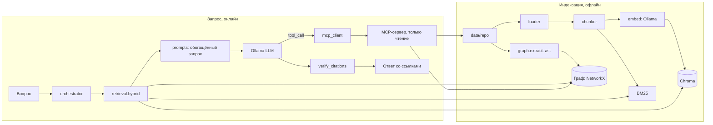

# Архитектура

```
 ИНДЕКСАЦИЯ (офлайн)
 data/repo ──> loader ──> chunker ──> embed ──> vectorstore (Chroma)
                              └────> lexical (BM25)
                 └──> graph.extract ──> graph.store (Kuzu | NetworkX)

 ЗАПРОС (онлайн)
 вопрос ──> orchestrator ──> retrieval.hybrid (вектор + BM25 + обход графа)
                │                      │
                │                      v
                │            prompts: обогащённый запрос ──> Ollama (LLM)
                │                                              │ tool_call
                │<──────── mcp_client <── MCP-сервер <─────────┘
                v
          verify_citations ──> ответ со ссылками [путь:строки]
```

Соответствие блокам схемы Гапанюка и владельцам: `OWNERS.md`.

## Схема потока данных (Mermaid)


